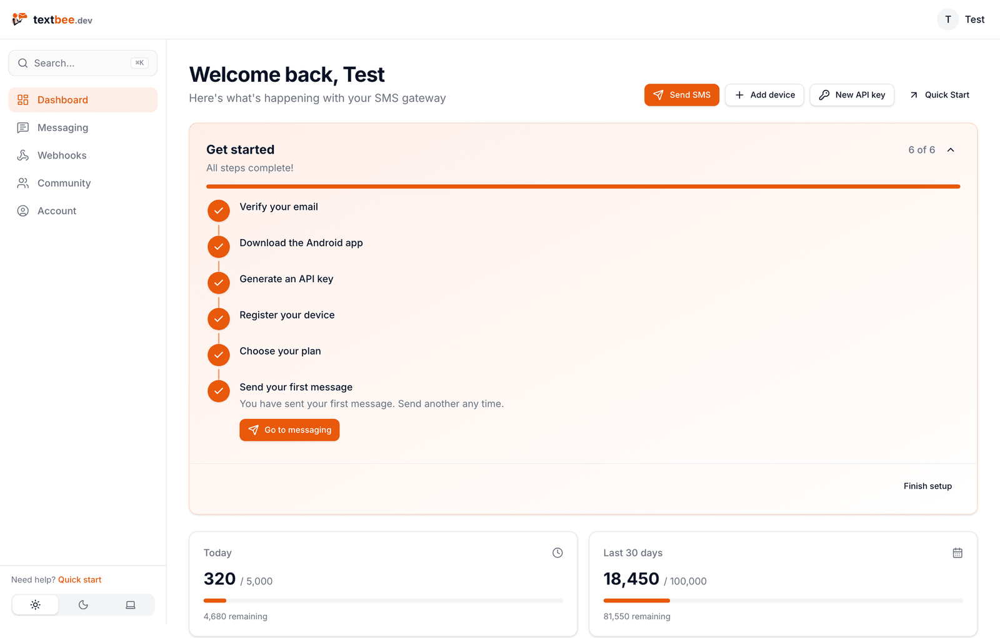
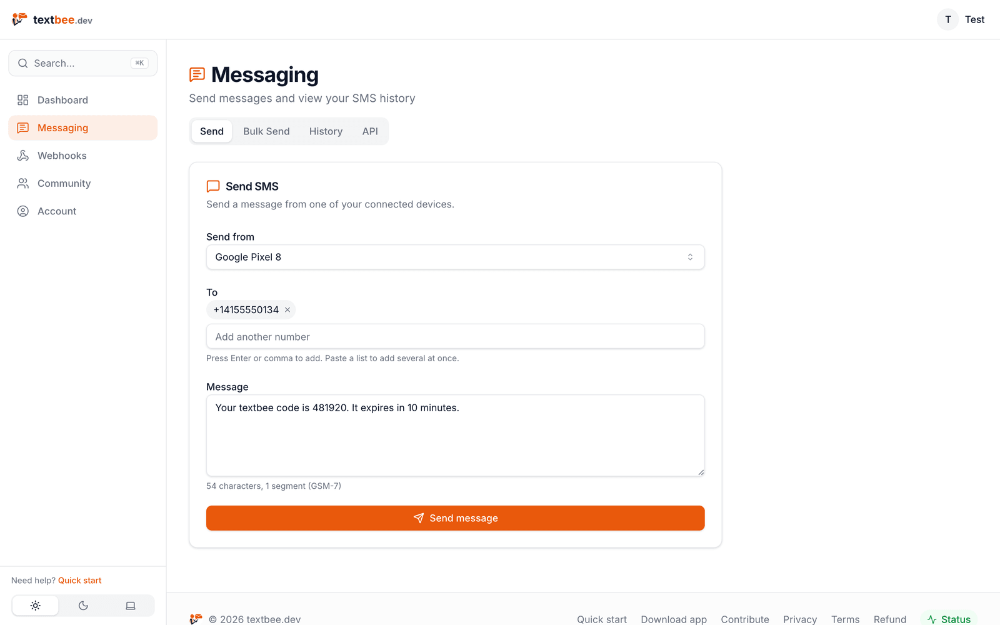
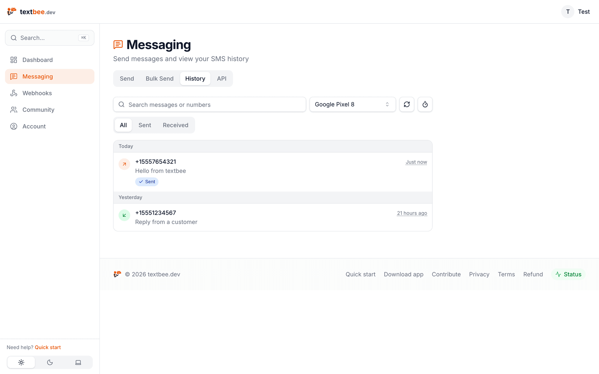
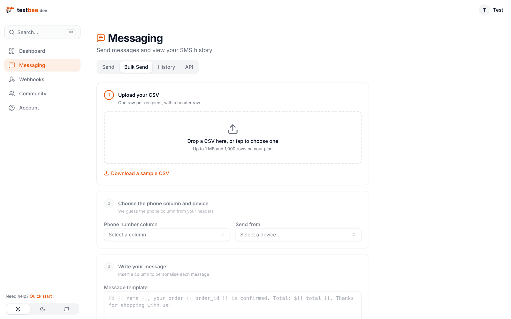
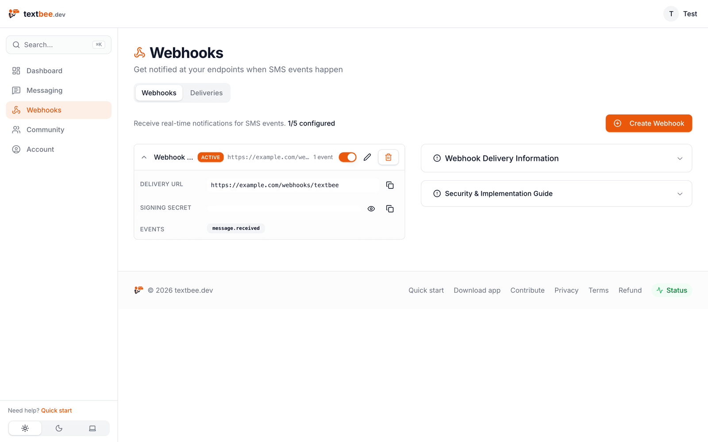
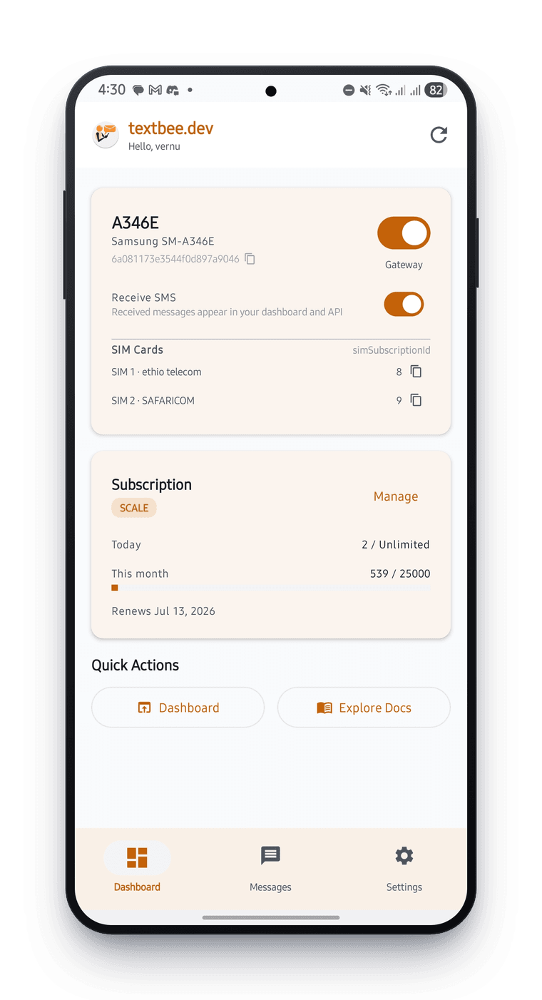
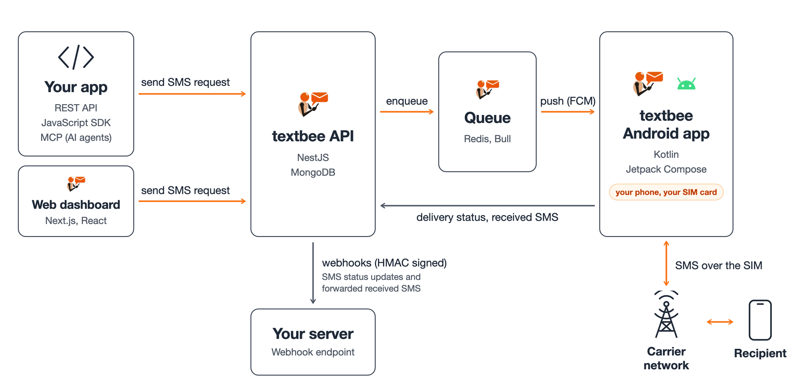

<p align="center">
  <a href="https://textbee.dev?ref=gh-readme">
    
  </a>
</p>

<h1 align="center">textbee: open-source Android SMS gateway</h1>

<p align="center">
  Turn an Android phone into an SMS API. Send and receive text messages from your apps, scripts, and AI agents over REST, webhooks, and MCP.<br>
  No Twilio account, no rented number, no per-message fees. Self-host it or use the free hosted plan.
</p>

<p align="center">
  <a href="https://textbee.dev?ref=gh-readme"><b>Website</b></a> ·
  <a href="https://textbee.dev/docs?ref=gh-readme"><b>Docs</b></a> ·
  <a href="https://textbee.dev/docs/api-reference?ref=gh-readme"><b>API reference</b></a> ·
  <a href="https://textbee.dev/download?ref=gh-readme"><b>Download the app</b></a> ·
  <a href="https://textbee.dev/discord"><b>Discord</b></a> ·
  <a href="#self-hosting"><b>Self-host</b></a>
</p>

<p align="center">
  <a href="https://github.com/textbee/textbee"></a>
  <a href="https://github.com/textbee/textbee/releases"></a>
  <a href="LICENSE"></a>
  <a href="https://github.com/textbee/textbee/actions/workflows/api.yaml"></a>
  <a href="https://github.com/textbee/textbee/actions/workflows/web.yaml"></a>
  <a href="https://github.com/textbee/textbee/actions/workflows/android.yaml"></a>
  <a href="https://www.npmjs.com/package/@textbee/sdk"></a>
  <a href="https://textbee.dev/discord"></a>
</p>

<p align="center">
  <a href="https://textbee.dev/dashboard?ref=gh-readme">
    
  </a>
</p>

## What is textbee?

textbee is a free, open-source **SMS gateway** that uses an Android phone and its SIM card to send and receive SMS. Your code talks to a REST API, the API pushes each message to the phone, and the phone sends it over the carrier network. Incoming messages flow back to you through the API, the web dashboard, or webhooks.

It is a drop-in **Twilio alternative** for OTP codes, alerts, reminders, and two-way SMS, at the cost of your carrier plan. Over 40,000 developers and businesses use it, and the whole stack is in this repository: the NestJS API, the Next.js dashboard, and the Kotlin Android app. textbee is built and maintained by [Nuver Labs](https://nuverlabs.com/?utm_source=textbee&utm_medium=github&utm_campaign=readme), a small software studio.

## Table of contents

- [Why textbee?](#why-textbee)
- [Features](#features)
- [Quick start](#quick-start)
- [Send an SMS](#send-an-sms)
- [Receive SMS](#receive-sms)
- [Webhooks](#webhooks)
- [Use with AI agents (MCP)](#use-with-ai-agents-mcp)
- [SDKs and integrations](#sdks-and-integrations)
- [Use cases](#use-cases)
- [Screenshots](#screenshots)
- [Stay up to date](#stay-up-to-date)
- [Self-hosting](#self-hosting)
- [Architecture](#architecture)
- [FAQ](#faq)
- [Contributing](#contributing)
- [Community and support](#community-and-support)
- [Who builds textbee](#who-builds-textbee)
- [Security](#security)
- [License](#license)

## Why textbee?

| | textbee | Twilio and similar SMS APIs |
|---|---|---|
| **Cost per SMS** | Your carrier plan, often free or unlimited | Per-message fee plus a monthly number fee |
| **Sender number** | Your own SIM. Recipients see a real local number | Rented number, often flagged as unknown |
| **Setup** | About 2 minutes: install the app, scan a QR code | Account approval, compliance forms, number registration |
| **Receive SMS** | Yes, on the same SIM | Yes, on the rented number |
| **Self-hostable** | Yes, full control over your data | No |
| **Open source** | Yes, MIT | No |
| **Works with AI agents** | Yes, official MCP server | Third-party only |

## Features

**Send**
- Send SMS from a REST API, the web dashboard, or the [JavaScript SDK](https://github.com/textbee/textbee-js)
- Bulk SMS with a CSV upload, paced to stay within carrier limits
- Scheduled messages up to 72 hours ahead
- Multi-device and multi-SIM: pick the phone and the SIM per message
- Delivery status for every message: `pending`, `dispatched`, `sent`, `delivered`, `failed`

**Receive**
- Receive SMS on the phone and read them from the API or dashboard
- Account-level message history: one call covers every device
- SMS filters on the phone: forward only the messages you need, with allow or block rules on sender and text

**Integrate**
- Webhooks for received messages and delivery reports, signed with HMAC-SHA256
- Official [MCP server](https://github.com/textbee/textbee-mcp) for Claude, Cursor, and other AI agents
- Guides for n8n, Zapier, Make, Home Assistant, Node-RED, Google Sheets, Slack, Shopify, WooCommerce, and GoHighLevel

**Operate**
- API keys with per-key revocation
- Web dashboard for devices, usage, history, and webhooks
- Self-host with Docker Compose, or use the hosted service at [textbee.dev](https://textbee.dev?ref=gh-readme)

## Quick start

You need an Android phone (Android 7.0 or newer) with a SIM card. The app is distributed as an APK from [textbee.dev/download](https://textbee.dev/download?ref=gh-readme), not through the Play Store.

1. Create an account at [textbee.dev](https://textbee.dev?ref=gh-readme).
2. Install the Android app from [textbee.dev/download](https://textbee.dev/download?ref=gh-readme) and grant it the SMS permissions.
3. In the [dashboard](https://textbee.dev/dashboard?ref=gh-readme), click **Add device** and scan the QR code with the app. This creates an API key and registers the phone.
4. Send your first message from the dashboard, or from your code as shown below.

That is the whole setup. The [getting started guide](https://textbee.dev/docs/getting-started?ref=gh-readme) covers each step with screenshots.

If textbee saves you money or time, [star the repo](https://github.com/textbee/textbee). It helps other developers find it.

## Send an SMS

One request. Messages go out through your default device, or the enabled device with the most recent heartbeat. Pass `deviceId` to pick a phone, `simSubscriptionId` to pick a SIM, or `scheduledAt` to send later.

```bash
curl -X POST "https://api.textbee.dev/api/v1/gateway/send-sms" \
  -H "x-api-key: YOUR_API_KEY" \
  -H "Content-Type: application/json" \
  -d '{
    "recipients": ["+12025550123"],
    "message": "Your verification code is 481920. It expires in 10 minutes."
  }'
```

<details>
<summary><b>JavaScript / TypeScript</b> (official SDK)</summary>

```bash
npm install @textbee/sdk
```

```js
import { Textbee } from '@textbee/sdk'

const textbee = new Textbee({ apiKey: process.env.TEXTBEE_API_KEY })

await textbee.sendSms({
  recipients: ['+12025550123'],
  message: 'Your verification code is 481920. It expires in 10 minutes.',
})
```

Zero dependencies, typed, runs on Node 18+, Bun, Deno, Cloudflare Workers, and Vercel Edge. See [textbee/textbee-js](https://github.com/textbee/textbee-js).

</details>

<details>
<summary><b>Node.js</b> (fetch, no SDK)</summary>

```js
await fetch('https://api.textbee.dev/api/v1/gateway/send-sms', {
  method: 'POST',
  headers: {
    'x-api-key': process.env.TEXTBEE_API_KEY,
    'Content-Type': 'application/json',
  },
  body: JSON.stringify({
    recipients: ['+12025550123'],
    message: 'Your verification code is 481920. It expires in 10 minutes.',
  }),
})
```

</details>

<details>
<summary><b>Python</b></summary>

```python
import requests

requests.post(
    "https://api.textbee.dev/api/v1/gateway/send-sms",
    json={
        "recipients": ["+12025550123"],
        "message": "Your verification code is 481920. It expires in 10 minutes.",
    },
    headers={"x-api-key": "YOUR_API_KEY"},
)
```

</details>

<details>
<summary><b>PHP</b></summary>

```php
$ch = curl_init('https://api.textbee.dev/api/v1/gateway/send-sms');
curl_setopt_array($ch, [
    CURLOPT_POST => true,
    CURLOPT_RETURNTRANSFER => true,
    CURLOPT_HTTPHEADER => ['x-api-key: YOUR_API_KEY', 'Content-Type: application/json'],
    CURLOPT_POSTFIELDS => json_encode([
        'recipients' => ['+12025550123'],
        'message' => 'Your verification code is 481920. It expires in 10 minutes.',
    ]),
]);
$response = curl_exec($ch);
```

</details>

<details>
<summary><b>Go</b></summary>

```go
body := strings.NewReader(`{"recipients":["+12025550123"],"message":"Your verification code is 481920. It expires in 10 minutes."}`)
req, _ := http.NewRequest("POST", "https://api.textbee.dev/api/v1/gateway/send-sms", body)
req.Header.Set("x-api-key", os.Getenv("TEXTBEE_API_KEY"))
req.Header.Set("Content-Type", "application/json")
resp, err := http.DefaultClient.Do(req)
```

</details>

Every endpoint, field, and error code is in the [API reference](https://textbee.dev/docs/api-reference?ref=gh-readme). The API also serves an interactive OpenAPI (Swagger) page at [api.textbee.dev](https://api.textbee.dev).

## Receive SMS

Turn on **Receive SMS** in the Android app. Incoming messages are then available from the API, the dashboard, and webhooks. History is account-level, so one call covers every device.

```bash
curl "https://api.textbee.dev/api/v1/gateway/messages?direction=received" \
  -H "x-api-key: YOUR_API_KEY"
```

```js
const messages = await textbee.getMessages({ direction: 'received' })
```

Read the [receiving SMS guide](https://textbee.dev/docs/receiving-sms?ref=gh-readme) for pagination, filters, and SIM details.

## Webhooks

Get events on your server the moment they happen. Create a subscription in the dashboard or through the API, then handle these events:

| Event | When it fires |
|---|---|
| `MESSAGE_RECEIVED` | The phone received an SMS |
| `MESSAGE_SENT` | The carrier accepted an outgoing SMS |
| `MESSAGE_DELIVERED` | The recipient's handset confirmed delivery |
| `MESSAGE_FAILED` | The message could not be sent |
| `SMS_STATUS_UPDATED` | Any status change on an outgoing message |

Every delivery carries an `X-Signature` header: the HMAC-SHA256 of the raw body, keyed with the subscription's signing secret. Verify it before you trust the payload.

```js
import { verifyWebhookSignature } from '@textbee/sdk'

app.post('/webhooks/textbee', express.raw({ type: 'application/json' }), async (req, res) => {
  const valid = await verifyWebhookSignature({
    payload: req.body.toString('utf8'),
    signature: req.get('x-signature'),
    signingSecret: process.env.TEXTBEE_WEBHOOK_SECRET,
  })
  if (!valid) return res.sendStatus(401)

  const event = JSON.parse(req.body.toString('utf8'))
  res.sendStatus(200)
})
```

Retries, pauses, and the full payload shape are in the [webhooks docs](https://textbee.dev/docs/webhooks?ref=gh-readme).

## Use with AI agents (MCP)

The official [textbee MCP server](https://github.com/textbee/textbee-mcp) gives Claude, Cursor, and any MCP-compatible client a phone number. Three tools: `send_sms` (one or many recipients), `get_messages` (read replies and verification codes, check delivery status), and `list_devices`. Plan limits apply server-side like any other send.

**claude.ai, Claude Desktop, and the Claude mobile apps** (nothing to install; the Free plan allows one custom connector):

1. In claude.ai or Claude Desktop, open **Customize**, then **Connectors**, then **+ Add** and **Add custom connector**.
2. Enter the name `textbee` and the URL `https://mcp.textbee.dev/mcp`, then click **Continue** twice.
3. Choose **Sign in now**, leave the OAuth client on the recommended option, and click **Add**.
4. Paste your API key on the textbee sign-in page and click **Connect**.

The mobile apps use connectors added on the web or desktop. On Team and Enterprise plans, an owner adds the connector for the organization first.

**Claude Code:**

```bash
# Hosted: run /mcp afterwards and choose Authenticate to sign in with your API key
claude mcp add --transport http -s user textbee https://mcp.textbee.dev/mcp

# Or local: the key stays on your machine
claude mcp add textbee -s user -e TEXTBEE_API_KEY=YOUR_API_KEY -- npx -y @textbee/mcp
```

**Cursor and other MCP clients** (local server, the key stays on your machine):

```json
{
  "mcpServers": {
    "textbee": {
      "command": "npx",
      "args": ["-y", "@textbee/mcp"],
      "env": { "TEXTBEE_API_KEY": "YOUR_API_KEY" }
    }
  }
}
```

With the hosted connector, textbee checks your key and does not store it. Self-hosted instances use the local server with `TEXTBEE_BASE_URL`. Full setup at [textbee.dev/mcp](https://textbee.dev/mcp?ref=gh-readme) and the [MCP docs](https://textbee.dev/docs/agents/mcp?ref=gh-readme).

## SDKs and integrations

| | What it is | Where |
|---|---|---|
| **JavaScript SDK** | `@textbee/sdk`: typed client, message iteration, webhook verification, segment counting | [textbee/textbee-js](https://github.com/textbee/textbee-js) · [npm](https://www.npmjs.com/package/@textbee/sdk) |
| **MCP server** | `@textbee/mcp`: send and read SMS from any MCP client, hosted or local | [textbee/textbee-mcp](https://github.com/textbee/textbee-mcp) · [npm](https://www.npmjs.com/package/@textbee/mcp) |
| **REST API** | Any language with an HTTP client | [API reference](https://textbee.dev/docs/api-reference?ref=gh-readme) |

Step-by-step guides for no-code and automation tools:

[n8n](https://textbee.dev/integrations/n8n?ref=gh-readme) · [Zapier](https://textbee.dev/integrations/zapier?ref=gh-readme) · [Make](https://textbee.dev/integrations/make?ref=gh-readme) · [Home Assistant](https://textbee.dev/integrations/home-assistant?ref=gh-readme) · [Node-RED](https://textbee.dev/integrations/node-red?ref=gh-readme) · [Google Sheets](https://textbee.dev/integrations/google-sheets?ref=gh-readme) · [Slack](https://textbee.dev/integrations/slack?ref=gh-readme) · [Shopify](https://textbee.dev/integrations/shopify?ref=gh-readme) · [WooCommerce](https://textbee.dev/integrations/woocommerce?ref=gh-readme) · [GoHighLevel](https://textbee.dev/integrations/gohighlevel?ref=gh-readme)

## Use cases

- **OTP and 2FA codes**: verification SMS from a local number your users recognize
- **Order and appointment notifications**: confirmations, reminders, and shipping updates from your own number
- **Alerts and monitoring**: server, cron, uptime, and home automation alerts that reach you even when push notifications do not
- **Two-way SMS**: reply handling, keyword opt-ins, and support conversations through webhooks
- **Lead follow-up and form-to-SMS**: text back a lead the moment a form is submitted
- **Bulk announcements**: CSV upload to a contact list, paced to respect carrier limits
- **AI agents**: let an agent send a text and read the reply

## Screenshots

<details>
<summary><b>Web dashboard and Android app</b></summary>

<p align="center">
  
</p>
<p align="center">
  
</p>
<p align="center">
  
</p>
<p align="center">
  
</p>
<p align="center">
  
</p>

</details>

## Stay up to date

textbee ships new features and fixes every few weeks across the API, the dashboard, and the Android app.

- **[Changelog](https://textbee.dev/changelog?ref=gh-readme)**: every user-facing change, newest first. Check it before you update the Android app or when an API field looks new.
- **[Blog](https://textbee.dev/blog?ref=gh-readme)**: guides and tutorials on SMS automation, OTP delivery, webhooks, self-hosting, and connecting textbee to tools like n8n, Zapier, and Home Assistant.
- **[GitHub releases](https://github.com/textbee/textbee/releases)**: tagged versions of this repository. Watch the repo to get notified.

## Self-hosting

textbee is fully self-hostable. You run the API, the web dashboard, MongoDB, and Redis. You create a Firebase project for push messages, and you build the Android app for your own domain. All messages and account data stay in your database.

The complete guide, with every environment variable explained, is at [textbee.dev/docs/self-hosting](https://textbee.dev/docs/self-hosting?ref=gh-readme). The short version is below.

### What you need

- A server with Docker, or with Node.js 22, `pnpm`, `pm2`, MongoDB, and Redis
- A domain with HTTPS. The phone and your code reach the API over the internet
- A [Firebase](https://firebase.google.com) project with Cloud Messaging enabled: a service account key for the API and a `google-services.json` for the Android app
- An SMTP account for verification emails and notices
- Android Studio or the Android SDK to build the app

### Run with Docker Compose

```bash
git clone https://github.com/textbee/textbee.git
cd textbee
cp api/.env.example api/.env
cp web/.env.example web/.env
```

Fill in both `.env` files. The ones that matter first:

| File | Variable | Value |
|---|---|---|
| `api/.env` | `MONGO_URI`, `MONGO_ROOT_USER`, `MONGO_ROOT_PASS` | Change the default user and password. The example URI already points at the `textbee-db` container |
| `api/.env` | `JWT_SECRET` | A long random string |
| `api/.env` | `FRONTEND_URL` | The public URL of your dashboard |
| `api/.env` | `FIREBASE_*` | Fields from your Firebase service account JSON |
| `api/.env` | `MAIL_*`, `ADMIN_EMAIL` | Your SMTP server |
| `api/.env` | `USE_SMS_QUEUE` | `true` to run sends through the Redis queue. Scheduled messages need it |
| `web/.env` | `NEXT_PUBLIC_API_BASE_URL` | Your API URL with `/api/v1` |
| `web/.env` | `NEXTAUTH_SECRET`, `NEXTAUTH_URL` | A long random string and the public dashboard URL |

Then start everything:

```bash
docker compose up -d
```

This builds the API and web images from source and starts them with MongoDB, Redis, and an optional Mongo Express admin UI. The dashboard listens on port 3000 and the API on port 3001. Stop with `docker compose down`.

### Run without Docker

<details>
<summary><b>API, web, and VPS setup</b></summary>

**API** (`api/`):

```bash
cd api
cp .env.example .env   # then fill it in
pnpm install
pnpm build
pm2 start dist/main.js --name textbee-api
```

**Web** (`web/`):

```bash
cd web
cp .env.example .env   # then fill it in
pnpm install
pnpm build
pm2 start pnpm --name textbee-web -- start
```

**Reverse proxy**: put both behind HTTPS. Example [Caddy](https://caddyserver.com) config:

```
sms.example.com {
    reverse_proxy /api/* localhost:3001
    reverse_proxy /* localhost:3000
}
```

MongoDB can run on the same server or on [MongoDB Atlas](https://www.mongodb.com/cloud/atlas). Redis runs the send queue and background jobs; point `REDIS_URL` at it.

</details>

### Build the Android app

The app must point at your domain and your Firebase project.

1. Place your `google-services.json` in `android/app/`.
2. Replace every occurrence of `textbee.dev` in the Android project with your own domain.
3. Build:

   ```bash
   cd android
   ./gradlew assembleRelease
   ```

Install the APK on the phone, then register it from your dashboard the same way as on the hosted service.

## Architecture

textbee has three parts: the API, the Android app, and the web dashboard. Your code never talks to the phone directly. It calls the API, and the API uses Firebase Cloud Messaging to push each message to the phone, which sends it over the carrier network through its own SIM.

<p align="center">
  
</p>

How a message flows:

1. **Your app sends a request** to the REST API, through the JavaScript SDK, or from an AI agent over MCP. The API checks the API key and plan limits, stores the message as `pending`, and picks the device.
2. **The API queues the send and pushes it to the phone** with Firebase Cloud Messaging. The queue runs on Redis and Bull. Bulk and scheduled sends wait there and are released in paced waves.
3. **The Android app sends the SMS** over the carrier network from the SIM you chose and reports back each state change: `dispatched`, `sent`, `delivered`, or `failed`.
4. **Incoming SMS go the other way.** The phone receives a message, the app uploads it to the API, and it appears in your message history.
5. **Webhooks notify your server.** The API forwards received SMS and SMS status updates to your webhook endpoint. Every delivery is signed with HMAC-SHA256 so you can verify it came from textbee.

The web dashboard is a Next.js app that calls the same API your code does. It is where you register devices, create API keys, send and read messages, and manage webhooks.

| Directory | What it is | Stack |
|---|---|---|
| [`api/`](api) | REST API, device registration, send queue, webhooks, billing | NestJS, MongoDB, Redis (BullMQ), Firebase Cloud Messaging |
| [`web/`](web) | Dashboard: devices, API keys, messaging, history, webhooks | Next.js, React, Tailwind CSS |
| [`android/`](android) | The gateway app: sends and receives SMS, reports status | Kotlin, Jetpack Compose, WorkManager |
| [`docker-compose.yaml`](docker-compose.yaml) | One-command self-hosted stack | Docker |

## FAQ

<details>
<summary><b>Does my phone need to stay on?</b></summary>

Yes. Messages are sent through the phone, so it needs power, the app, and an internet connection. A spare Android phone on a charger works well as a dedicated gateway. The [keep the phone online guide](https://textbee.dev/docs/troubleshooting/keep-the-phone-online?ref=gh-readme) lists the battery and background settings to change.

</details>

<details>
<summary><b>Will my carrier block my number for sending too many messages?</b></summary>

Carriers apply their own rate limits and anti-spam rules, which vary by country and plan. Personal and low-volume use is rarely a problem. For higher volume, spread sends across several devices or SIMs and keep rates reasonable. You are responsible for staying within your carrier's terms.

</details>

<details>
<summary><b>Is it legal to send marketing SMS this way?</b></summary>

SMS marketing is regulated in most countries. textbee is a tool. You are responsible for getting consent and following the laws that apply to you and your recipients.

</details>

<details>
<summary><b>Can I use more than one phone or SIM?</b></summary>

Yes. Register as many devices as your plan allows and pass `deviceId` to choose the phone. On dual-SIM phones, pass `simSubscriptionId` to choose the SIM. See [choosing a SIM](https://textbee.dev/docs/sending-sms/choosing-a-sim?ref=gh-readme).

</details>

<details>
<summary><b>Is the app on the Play Store?</b></summary>

No. Download the APK from [textbee.dev/download](https://textbee.dev/download?ref=gh-readme). The app needs SMS permissions that the Play Store restricts for this kind of app.

</details>

<details>
<summary><b>What does the hosted service cost?</b></summary>

There is a free plan, and paid plans with higher limits and more devices. See [textbee.dev/pricing](https://textbee.dev/pricing?ref=gh-readme). Self-hosting has no plan limits.

</details>

<details>
<summary><b>Does it work on iPhone?</b></summary>

No. iOS does not let apps send or read SMS on your behalf. The gateway app is Android only. You can still call the API from any device or platform.

</details>

## Contributing

Contributions are welcome: bug fixes, features, docs, and translations. Look for [good first issues](https://github.com/textbee/textbee/issues?q=is%3Aissue+is%3Aopen+label%3A%22good+first+issue%22) and [help wanted](https://github.com/textbee/textbee/issues?q=is%3Aissue+is%3Aopen+label%3A%22help+wanted%22) to get started.

1. [Fork](https://github.com/textbee/textbee/fork) the repo and create a branch from `main`.
2. Make your change with a clear commit message.
3. Open a pull request against `main` and describe what changed and why.

### Run it locally

```bash
# API (needs MongoDB; the Docker Compose file starts one)
cd api && cp .env.example .env && pnpm install && pnpm start:dev

# Web dashboard
cd web && cp .env.example .env && pnpm install && pnpm dev

# Tests
cd api && pnpm exec jest
cd web && pnpm test
```

Open the Android project in Android Studio from the `android/` folder. It has `dev` and `prod` build variants, described in [android/BUILD_VARIANTS_SETUP.md](android/BUILD_VARIANTS_SETUP.md).

## Community and support

- [Discord](https://textbee.dev/discord): questions, help, and announcements
- [GitHub issues](https://github.com/textbee/textbee/issues/new): bug reports and feature requests
- [Docs](https://textbee.dev/docs?ref=gh-readme) and [FAQ](https://textbee.dev/docs/faq?ref=gh-readme)
- Email: [contact@textbee.dev](mailto:contact@textbee.dev)

## Who builds textbee

textbee is built and maintained by [Nuver Labs](https://nuverlabs.com/?utm_source=textbee&utm_medium=github&utm_campaign=readme), a small software studio that makes developer tools and AI products. The team also offers [custom development](https://textbee.dev/services?ref=gh-readme): integrations, SMS workflows, and self-hosted setups built on textbee.

## Security

Do not open a public issue for a vulnerability. Email [contact@textbee.dev](mailto:contact@textbee.dev) with the details. See [SECURITY.md](SECURITY.md).

## License

textbee is open source under the [MIT License](LICENSE).
